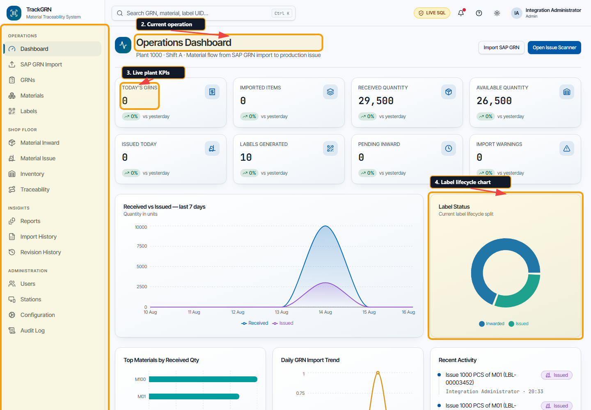
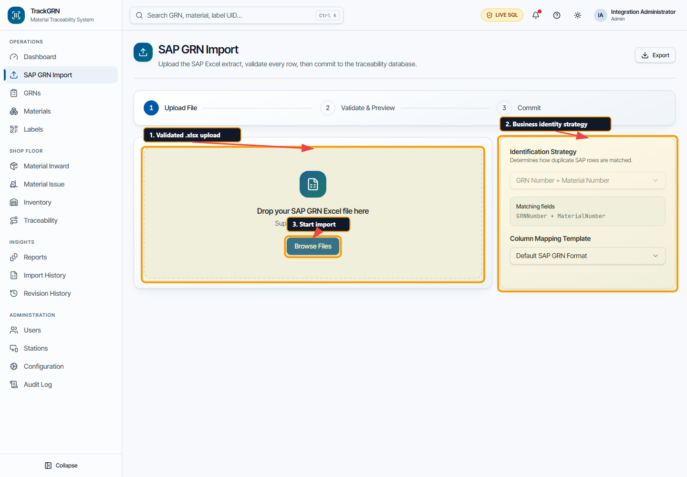
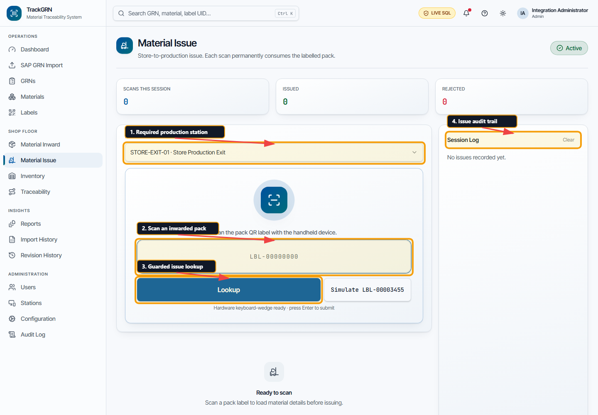
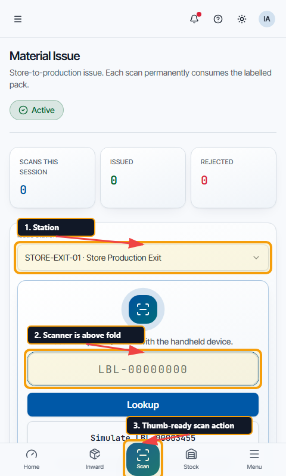
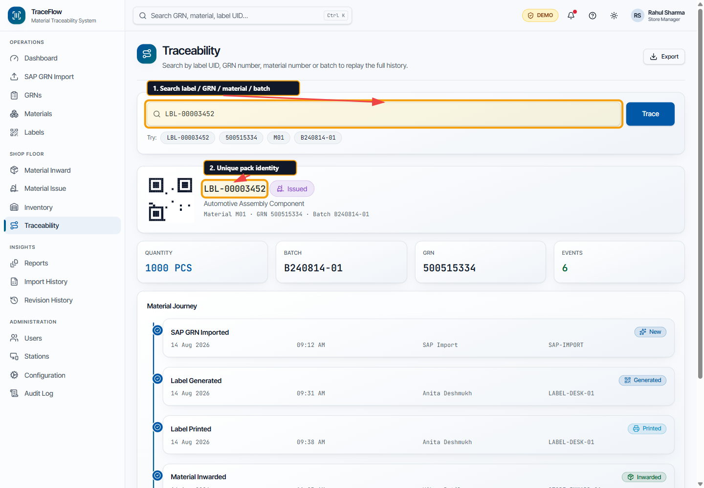
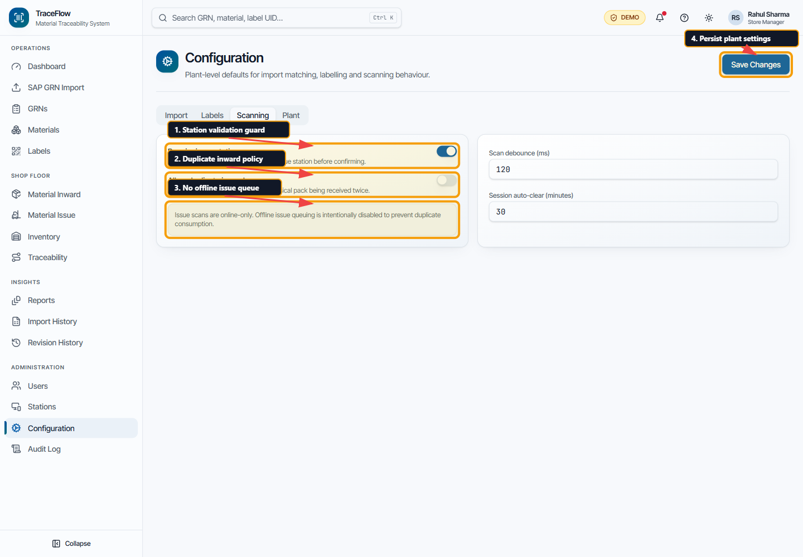

# TrackGRN Operator User Guide

## 1. Sign in

Open TrackGRN and use the assigned plant credentials. For the current demo UI:

- Username: `admin`
- Password: `admin123`

Invalid credentials are rejected. The login button stays disabled until the application is fully ready, preventing accidental native form submission on a slow plant terminal.

## 2. Dashboard

The dashboard provides current GRN, received, available, issue, inward and warning KPIs. Use the left navigation on desktop or bottom navigation on a handheld.

1. The left rail opens operational, shop-floor, insight and administration modules.
2. The page heading confirms the current operation.
3. KPI cards show plant-level counts and quantities.
4. Charts show received/issued movement and label lifecycle status.

Press `Ctrl+K` on desktop to focus global search. Enter a label UID, GRN, material or batch and press Enter to open Traceability.

## Material and Vendor bulk upload

1. Open **Materials** or **Vendors** and select **Download Material Template** or **Download Vendor Template**. The same download is available inside **Bulk Upload**.
2. Fill the **Materials** or **Vendors** worksheet from row 2. Keep the header row unchanged. Dark blue headers are required; the **Instructions** sheet explains every column and gives examples. The data sheet is blank so sample records are never uploaded accidentally.
3. Keep codes as text to preserve leading zeros. Save as **.xlsx** and upload the saved workbook directly in **Bulk Upload**. Existing CSV files are also accepted. Limit: **2,000 populated rows / 5 MB**.
4. Review errors and the **Create / Update** actions before selecting **Upload valid rows**. Duplicate codes in the file are rejected. Existing codes are updated; new codes are created. Blank optional fields use defaults or clear the prior value.

Material required columns: **Material Number, Description, UOM, Pack Quantity** (greater than zero). Optional: **Part Number, Default Bin, Opening Quantity, Active**. Opening Quantity is a reference value and does not inward stock.

Vendor required columns: **Vendor Code, Vendor Name**. Optional: **Aliases (use | between values), Active**. Separate alternative names with `|`. Active accepts TRUE/FALSE and defaults to TRUE when blank.

## 3. Import an SAP GRN file

1. Open **SAP GRN Import**.
2. Drop or browse for an `.xlsx` file. Other formats and files above 10 MB are rejected.
3. Select the identification strategy that matches the plant's SAP business identity rule.
4. Select the column-mapping template.
5. Review New, Updated, Unchanged, Warning and Rejected rows.
6. Select **Commit Import**, verify the summary, then confirm.

Never commit rejected rows without resolving their stated reason. A revised SAP extract must never reduce received quantity below material already issued.

## 4. Labels

Open **Sticker Printing** after committing the SAP Excel import. New pack labels are generated and inwarded automatically, so no separate inward scan is required.

- **Pending Printing** shows one row per GRN, material and UOM, with **12 rows per page**. Quantity and label counts cover all unprinted packs, including groups larger than 2,000 labels. Search and filters run on the server.
- **Print labels** opens every pending pack in that part. **Print All** opens all matching parts across pages. Select a From/To range of up to 500 labels per run.
- **Printer** sends each sticker to the configured Zebra printer/Print Agent. Retry sends only the failures. A simulation result is explicitly identified and does not establish that a physical sticker printed.
- **PDF** opens one **100 x 75 mm** page per selected pack and records the output in history. Print at **Actual size / 100%** with 100 x 75 mm paper. API access is required to record the output.
- **Reprint History** contains printed/PDF-prepared labels, including older records. Search by Label ID, GRN or part, select the original sticker and enter a reprint reason. Reprinting retains the Label ID and does not add stock or repeat inward.

Every QR contains **only the Label ID**. Material, GRN, quantity, date and pack information remain readable. Batch is omitted from the preview and both output formats. Old multiline stickers remain compatible with the scanner.

## 5. Automatic material inward

Excel import and manual label generation record one inward transaction per new pack. Unprinted packs can still be reconciled when SAP quantities or packing standards change. Once a pack has been printed or issued, reconciliation protects it. Reprints never repeat inward. The legacy inward endpoint rejects duplicate processing.

## 6. Issue material to production

1. Open **Material Issue** and confirm the production station.
2. Scan the pack label and press Enter (or use the scanner's Enter suffix). A full QR payload is accepted: only its **Label ID** value is used; GRN, material, quantity and date lines are ignored. A plain Label UID also works. For pasted data, click **Scan & Issue** or press Enter. The system reads the actual material and quantity from the saved label record.
3. Review material, quantity, GRN and batch in the confirmation dialog.
4. Select **Confirm Issue** once.

Only Inwarded labels can issue. Issue is intentionally online-only: if the red offline banner appears, restore the LAN connection before continuing. Generated, printed, duplicate, blocked and cancelled scans are rejected.

### Zebra 480 × 800 layout

The station and scan input are kept in the initial handheld viewport. The raised center **Scan** action is thumb-accessible from the bottom navigation.

## 7. Traceability

Search by:

- Label UID, for one physical pack journey
- GRN number, for receipt-related labels
- Material number
- Batch

The result shows current status and lifecycle events from label generation and printing through inward and production issue. Use Export when an audit copy is required.

## 8. Scanning policy

Administrators can require an issue station and control the duplicate-inward policy. Keep duplicate inward disabled for normal production. Offline issue queuing is intentionally unavailable because replaying queued scans could consume one pack twice.

## 9. Common rejection messages

| Message | Operator action |
|---|---|
| Label not found in system | Check the full UID and confirm that its GRN import/label generation completed |
| Label already inwarded | Do not inward again; use Traceability to verify the first event |
| Label must be inwarded before issue | Generate the pack or check the imported label status |
| Label already issued to production | Stop and verify the physical pack and trace history |
| Label is blocked/cancelled | Contact the store manager or administrator |
| You are offline | Restore the plant LAN before issuing |

## 10. Test and support evidence

The automated test report is [PLAYWRIGHT-TEST-REPORT.md](PLAYWRIGHT-TEST-REPORT.md). It includes the covered routes, defect resolutions, commands, responsive profiles, accessibility result and known integration boundaries.
